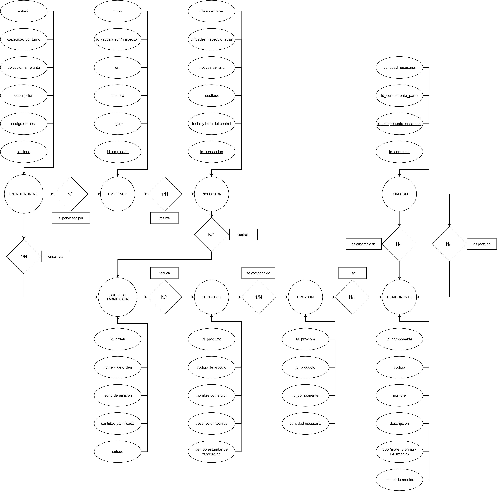

# BASE DE DATOS — Ejercicio 18: Gestión de Producción Industrial y Control de Calidad en una Fábrica

Trabajo práctico de Base de Datos (Universidad Champagnat). Este repositorio contiene todo el desarrollo del ejercicio 18: modelo entidad-relación, modelo relacional y normalización (1FN, 2FN y 3FN).

## Consigna


#### Contexto

Una planta industrial de manufactura metálica requiere un sistema de control de producción para planificar el ensamblaje de productos terminados a partir de piezas primas, supervisar las líneas de montaje y registrar las inspecciones de control de calidad.


#### Consigna

Modelar mediante el MER la operación de la planta industrial bajo los siguientes lineamientos:

La fábrica produce artículos finales. De cada producto se conoce su código de artículo, nombre comercial, descripción técnica y tiempo estándar de fabricación.

Los productos se componen de materias primas y componentes intermedios (Lista de Materiales o BOM - Bill of Materials). Un producto requiere múltiples componentes, y un componente puede formar parte de distintos productos, especificando la cantidad exacta necesaria.

La producción se organiza en órdenes de fabricación. Cada orden posee un número de orden, fecha de emisión, cantidad planificada a producir, estado (En curso, Finalizada, Cancelada) y la línea de montaje asignada.

Las líneas de montaje se identifican por un código de línea, descripción y el supervisor a cargo (empleado de la planta).

Las unidades producidas son sometidas a rigurosas inspecciones de control de calidad. Cada inspección registra la fecha y hora del control, el inspector a cargo (empleado), el resultado de la prueba (Aprobado, Rechajado, Rework) y los motivos detallados en caso de falla.


#### Desarrollo requerido


Modelar la autorrelación N:M recursiva en la entidad Componente / Pieza para representar la estructura de ensamblaje (BOM).

Establecer la relación entre Orden de Fabricación, Producto y Línea de Montaje.

Definir la entidad Empleado, especificando sus roles como supervisor de línea o inspector de calidad.

Diseñar la entidad Inspección de Calidad asociada a las unidades de producción o lotes fabricados.

## Estructura del repositorio

```
BASE_DE_DATOS_Ejercicio_18/
├── README.md
├── modelo-er/
│   ├── ejercicio_18.drawio        # diagrama editable (draw.io)
│   └── ejercicio_18.png           # exportación del diagrama
├── modelo-relacional/
│   ├── ejercicio_18_MR.xlsx               # modelo relacional
│   └── ejercicio_18_con_datos.xlsx        # modelo relacional con datos de ejemplo
└── normalizacion/
    ├── ejercicio_18_1FN.xlsx
    ├── ejercicio_18_2FN.xlsx
    └── ejercicio_18_3FN.xlsx
```

## Modelo entidad-relación



Archivo editable: [`modelo-er/ejercicio_18.drawio`](modelo-er/ejercicio_18.drawio).

## Modelo relacional

Tablas del modelo relacional original, antes de normalizar (`(PK)` clave primaria, `(FK)` clave foránea, `(UNIQUE)` valor único):

- **EMPLEADO**: `Id_empleado(PK)`, `legajo(UNIQUE)`, `nombre`, `dni(UNIQUE)`, `rol (supervisor / inspector)`, `turno`
- **LINEA DE MONTAJE**: `Id_linea(PK)`, `codigo de linea(UNIQUE)`, `descripcion`, `ubicacion en planta`, `capacidad por turno`, `estado`, `Id_empleado(FK)`
- **PRODUCTO**: `Id_producto(PK)`, `codigo de articulo(UNIQUE)`, `nombre comercial`, `descripcion tecnica`, `tiempo estandar de fabricacion`
- **ORDEN DE FABRICACION**: `Id_orden(PK)`, `numero de orden(UNIQUE)`, `fecha de emision`, `cantidad planificada`, `estado`, `Id_linea(FK)`, `Id_producto(FK)`
- **INSPECCION**: `Id_inspeccion(PK)`, `fecha y hora del control`, `resultado`, `motivos de falla`, `unidades inspeccionadas`, `observaciones`, `Id_empleado(FK)`, `Id_orden(FK)`
- **COMPONENTE**: `Id_componente(PK)`, `codigo(UNIQUE)`, `nombre`, `descripcion`, `tipo (materia prima / intermedio)`, `unidad de medida`
- **PRO-COM**: `Id_pro-com(PK)`, `Id_producto(FK, PK)`, `Id_componente(FK, PK)`, `cantidad necesaria`
- **COM-COM**: `Id_com-com(PK)`, `Id_componente_ensamble(FK, PK)`, `Id_componente_parte(FK, PK)`, `cantidad necesaria`

Archivos: [`ejercicio_18_MR.xlsx`](modelo-relacional/ejercicio_18_MR.xlsx) y [`ejercicio_18_con_datos.xlsx`](modelo-relacional/ejercicio_18_con_datos.xlsx).

## Lógica relacional

Cada entidad se convierte en una tabla con su clave primaria. Las relaciones se representan así:

- **1:N / N:1**: la clave primaria del lado "uno" se copia como clave foránea (FK) en la tabla del lado "muchos".
- **1:1**: igual que 1:N, pero la FK lleva restricción UNIQUE.
- **N:M**: se crea una tabla intermedia cuyas FK forman una clave compuesta, junto con una clave propia que se identifica por esa combinación.

Relaciones del modelo final (3FN):

- `LINEA DE MONTAJE` → `EMPLEADO`: **N:1** (FK `id_empleado` en `LINEA DE MONTAJE`).
- `ORDEN DE FABRICACION` → la entidad referida por `id_linea`: **N:1** (FK `id_linea` en `ORDEN DE FABRICACION`).
- `ORDEN DE FABRICACION` → `PRODUCTO`: **N:1** (FK `id_producto` en `ORDEN DE FABRICACION`).
- `INSPECCION` → `EMPLEADO`: **N:1** (FK `id_empleado` en `INSPECCION`).
- `INSPECCION` → la entidad referida por `id_orden`: **N:1** (FK `id_orden` en `INSPECCION`).
- `PRODUCTO` ↔ `COMPONENTE`: relación **N:M**, resuelta con la tabla intermedia `PRO-COM` (sus FK forman la clave compuesta única).
- `COMPONENTE_ENSAMBLE` ↔ `COMPONENTE_PARTE`: relación **N:M**, resuelta con la tabla intermedia `COM-COM` (sus FK forman la clave compuesta única).

## Normalización

Los cambios se muestran etapa por etapa; cada etapa parte del resultado de la anterior.

### Primera forma normal (1FN)

Sin cambios respecto de la etapa anterior: el modelo ya cumplía esta forma normal.

### Segunda forma normal (2FN)

Sin cambios respecto de la etapa anterior: el modelo ya cumplía esta forma normal.

### Tercera forma normal (3FN)

Sin cambios respecto de la etapa anterior: el modelo ya cumplía esta forma normal.

#### Modelo final en 3FN

- **EMPLEADO**: `Id_empleado(PK)`, `legajo(UNIQUE)`, `nombre`, `dni(UNIQUE)`, `rol (supervisor / inspector)`, `turno`
- **LINEA DE MONTAJE**: `Id_linea(PK)`, `codigo de linea(UNIQUE)`, `descripcion`, `ubicacion en planta`, `capacidad por turno`, `estado`, `Id_empleado(FK)`
- **PRODUCTO**: `Id_producto(PK)`, `codigo de articulo(UNIQUE)`, `nombre comercial`, `descripcion tecnica`, `tiempo estandar de fabricacion`
- **ORDEN DE FABRICACION**: `Id_orden(PK)`, `numero de orden(UNIQUE)`, `fecha de emision`, `cantidad planificada`, `estado`, `Id_linea(FK)`, `Id_producto(FK)`
- **INSPECCION**: `Id_inspeccion(PK)`, `fecha y hora del control`, `resultado`, `motivos de falla`, `unidades inspeccionadas`, `observaciones`, `Id_empleado(FK)`, `Id_orden(FK)`
- **COMPONENTE**: `Id_componente(PK)`, `codigo(UNIQUE)`, `nombre`, `descripcion`, `tipo (materia prima / intermedio)`, `unidad de medida`
- **PRO-COM**: `Id_pro-com(PK)`, `Id_producto(FK, PK)`, `Id_componente(FK, PK)`, `cantidad necesaria`
- **COM-COM**: `Id_com-com(PK)`, `Id_componente_ensamble(FK, PK)`, `Id_componente_parte(FK, PK)`, `cantidad necesaria`

Archivos: [`ejercicio_18_1FN.xlsx`](normalizacion/ejercicio_18_1FN.xlsx), [`ejercicio_18_2FN.xlsx`](normalizacion/ejercicio_18_2FN.xlsx), [`ejercicio_18_3FN.xlsx`](normalizacion/ejercicio_18_3FN.xlsx).
